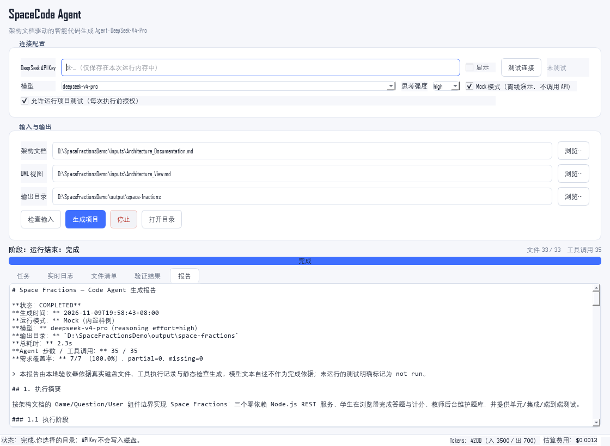
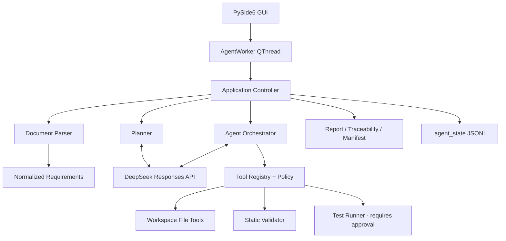

# SpaceCode Agent

**Architecture-document-driven code agent for Windows** — turns two architecture Markdown files into a
real, tested project, then reports exactly what was implemented.

[](https://www.python.org/)
[](https://doc.qt.io/qtforpython-6/)
[](#testing)
[](LICENSE)

SpaceCode Agent reads `Architecture_Documentation.md` and `Architecture_View.md`, normalizes requirements
and 13 PlantUML diagrams, plans a project, writes files through a confined tool layer, validates the result,
runs approved tests, and produces a traceable report. The desktop app is packaged as a single Windows `.exe`
that does not require Python on the target machine.

> 输入两份架构文档，输出一套可运行、可测试、可追溯的源码工程，而不是一段聊天文本。

---

## Highlights

- **Real files, not chat output** — every source file is written through `write_file`/`replace_in_file`
  into a confined workspace, with SHA-256 provenance.
- **DeepSeek-V4-Pro via official API** — Responses API at `https://api.deepseek.com`, native function
  calling, `reasoning.effort`, retries for 429/5xx/network failures, no model substitution.
- **Auditable requirement coverage** — explicit FR/NFR/ASR plus use-case-derived requirements, mapped to
  source and test files, exported as `traceability_matrix.csv` and `run_manifest.json`.
- **Safety enforced in Python** — path canonicalization, junction/symlink escape checks, atomic writes,
  overwrite protection, secret redaction, no arbitrary shell.
- **Bounded autonomy** — step/token/cost/time budgets, repair rounds, cancellation, and a completion
  check that the model cannot bypass.
- **Offline demo** — Mock mode replays a built-in Space Fractions project through the real tool layer,
  so the full pipeline is testable without an API key.



## Architecture



Pipeline: `VALIDATING_INPUT → NORMALIZING → PLANNING → IMPLEMENTING → VERIFYING → REPORTING`.

## Quick start

Requirements: Windows 10/11 x64, Python 3.11+ (verified with 3.14).

```powershell
git clone https://github.com/<your-account>/space-code-agent.git
cd space-code-agent
python -m venv .venv
.\.venv\Scripts\Activate.ps1
pip install -r requirements.txt
python -m space_code_agent
```

In the window:

1. Enter a DeepSeek API key — or tick **Mock mode** to run without one.
2. Select both Markdown files (sample inputs are in [`examples/inputs`](examples/inputs)).
3. Select an output directory. If it is not empty, the agent creates a unique subdirectory.
4. Click **Check inputs**, then **Generate project**.
5. Follow the phase, file and tool counters; view the generated report when finished.

### Mock mode (no API key)

```powershell
python -m space_code_agent --mock-run .\out\demo `
  --doc .\examples\inputs\Architecture_Documentation.md `
  --uml .\examples\inputs\Architecture_View.md --allow-tests
```

Mock mode replaces only the model. Parsing, planning, path policy, file writes, validation, tests and
reporting all run through the production code paths.

### Real model

```powershell
$env:DEEPSEEK_API_KEY = "sk-..."
python -m space_code_agent --run .\out\real `
  --doc .\examples\inputs\Architecture_Documentation.md `
  --uml .\examples\inputs\Architecture_View.md --allow-tests
```

The endpoint is fixed to `https://api.deepseek.com`; the default model is `deepseek-v4-pro` and the
reasoning effort is `high` (switchable to `max` in the GUI). No proxy or fallback model is used.

> A real API run is not included in this repository. See [TEST_REPORT](docs/TEST_REPORT.md) for what
> was actually executed and what is explicitly marked `not run`.

## Build the Windows EXE

```powershell
powershell -ExecutionPolicy Bypass -File .\scripts\build_windows.ps1 -Clean
```

Output: `dist\SpaceCodeAgent.exe` (one-file, PySide6 and sample data embedded). For faster local debugging:

```powershell
powershell -ExecutionPolicy Bypass -File .\scripts\build_windows.ps1 -Onedir -Clean
```

The procedure is also automated by [`.github/workflows/windows-build.yml`](.github/workflows/windows-build.yml),
which uploads the EXE as a workflow artifact. Binaries are intentionally **not committed** to the repository.

## Testing

```powershell
python -m pytest tests -q
```

The suite covers parsing (including the 13 PlantUML blocks), conflict detection, path attacks, tool
schema errors, retry/auth handling, cancellation, budgets, repair-on-rejection, Mock end-to-end and GUI
smoke tests. Current status: **80 passed**.

The built-in Space Fractions project has its own zero-dependency test suite (Node.js ≥ 20):

```powershell
cd src\space_code_agent\samples\space_fractions
node --test tests/unit services\question-service\tests services\game-service\tests services\user-service\tests
node --test tests/e2e
```

## Project layout

```text
space-code-agent/
├── src/space_code_agent/
│   ├── __main__.py              # GUI / headless / smoke entry
│   ├── app/                     # config, events, controller
│   ├── ui/                      # main window, worker, approval bridge
│   ├── core/                    # parser, requirements, delivery, report, session, sample project
│   ├── providers/               # DeepSeek Responses API, mock provider
│   ├── agent/                   # orchestrator, planner, prompts
│   ├── tools/                   # registry, filesystem, search, validation, runner
│   ├── security/                # path policy, secret redaction
│   └── samples/space_fractions/ # built-in runnable example
├── tests/                       # pytest suite
├── scripts/                     # PyInstaller entry/build/version metadata
├── examples/                    # sample inputs + sanitized report
├── docs/                        # user guide, test report, development log, screenshots
├── .github/workflows/           # Windows CI build
├── requirements.txt / pyproject.toml
└── README.md
```

## What gets generated

```text
<output>/
├── README.md
├── package.json / requirements.txt
├── src/ or services/ or apps/
├── tests/
├── docs/ASSUMPTIONS.md
├── GENERATION_REPORT.md
├── traceability_matrix.csv      # UTF-8 BOM, Excel-friendly
├── run_manifest.json            # machine-readable run record
└── .agent_state/<session>/      # audit JSONL (hidden, excluded from reports)
```

A sanitized example is available at [`examples/report-sample`](examples/report-sample).

## Safety model

- Relative paths only; absolute paths, drive letters, UNC, `\\?\`, `..`, ADS and Windows device names
  are rejected. Resolved real paths must stay inside the workspace.
- Writes use a same-directory temporary file + `os.replace()`; existing files are protected unless
  `overwrite=true`; input documents and credential-shaped filenames cannot be written.
- API keys are held in memory, masked in the UI, and scrubbed from logs, reports and manifests.
- Shell execution is disabled by default. Only `node --test`, `npm test` and `pytest` profiles are
  available, each requiring explicit GUI approval, with a timeout and a sanitized environment.
- **There is no OS-level sandbox.** Path confinement and command allowlists are not a substitute for
  one. Do not run untrusted generated projects with administrator privileges.

## Limitations

- The built-in demo keeps service boundaries but uses `node:http` instead of Express, in-memory
  repositories instead of a live PostgreSQL cluster, and does not deploy Redis/RabbitMQ/Elasticsearch/
  Kubernetes/Istio/Vault/Terraform. This is documented as a major deviation in the generated
  `ASSUMPTIONS.md`; it is not production-ready.
- Tests for generated Node projects require Node.js ≥ 20. Without it, the report marks them `not run`.
- The GUI is Windows-first; the Python core is portable but the packaged EXE targets Windows x64.
- Session-resume UI, diff preview and streaming reasoning display are not implemented.

## License

MIT — see [LICENSE](LICENSE).
